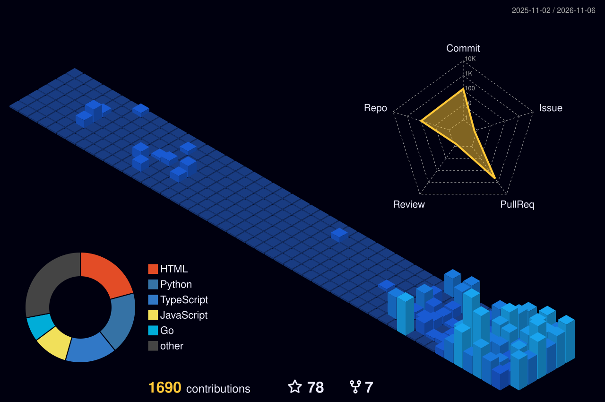

# REGINALD ALFRET V
### OPEN-SOURCE CONTRIBUTOR · AI & DS ENGINEER · SOFTWARE DEVELOPER

 

&nbsp;

&nbsp;

 

---

## ⚡ OPEN-SOURCE CONTRIBUTIONS
### 30 pull requests merged across leading engineering organisations

<table width="100%" border="0" cellpadding="8" cellspacing="0">
<tr>
<td width="20%" valign="top">

**🍎 Apple** [#355](https://github.com/apple/swift-numerics/pull/355)  
`swift-numerics`

</td>
<td width="20%" valign="top">

**🌐 Google** [#3511](https://github.com/google/highway/pull/3511)  
`Highway`

</td>
<td width="20%" valign="top">

**☁️ Google Cloud** [#1863](https://github.com/GoogleCloudPlatform/professional-services-data-validator/pull/1863)  
`Data Validator`

</td>
<td width="20%" valign="top">

**💻 Microsoft** [#14472](https://github.com/microsoft/semantic-kernel/pull/14472)  
`Semantic Kernel`

</td>
<td width="20%" valign="top">

**📦 AWS** [#8542](https://github.com/aws-powertools/powertools-lambda-python/pull/8542)  
`Lambda Powertools`

</td>
</tr>
<tr>
<td width="20%" valign="top">

**📘 Meta** [#1899](https://github.com/facebook/stylex/pull/1899)  
`StyleX`

</td>
<td width="20%" valign="top">

**🟢 NVIDIA** [#2068](https://github.com/NVIDIA/cuopt/pull/2068)  
`cuOpt`

</td>
<td width="20%" valign="top">

**🚀 NASA** [#237](https://github.com/nasa/prog_models/pull/237)  
`ProgPy`

</td>
<td width="20%" valign="top">

**🔷 Azure** [#359](https://github.com/Azure/azure-cosmos-db-emulator-docker/pull/359)  
`Cosmos DB Emulator`

</td>
<td width="20%" valign="top">

**🔴 Adobe** [#445](https://github.com/adobe/skills/pull/445)  
`Skills`

</td>
</tr>
<tr>
<td width="20%" valign="top">

**🧪 Intel** [#2421](https://github.com/intel/auto-round/pull/2421)  
`AutoRound`

</td>
<td width="20%" valign="top">

**📚 IBM** [#85](https://github.com/IBM/docling-pipelines/pull/85)  
`Docling Pipelines`

</td>
<td width="20%" valign="top">

**🚗 Uber** [#716](https://github.com/uber/kraken/pull/716)  
`Kraken`

</td>
<td width="20%" valign="top">

**🌺 Airbnb** [#169](https://github.com/airbnb/MagazineLayout/pull/169)  
`MagazineLayout`

</td>
<td width="20%" valign="top">

**⚫ GitHub** [#14592](https://github.com/cli/cli/pull/14592)  
`GitHub CLI`

</td>
</tr>
<tr>
<td width="20%" valign="top">

**🖥️ Dell** [#649](https://github.com/dell/omnia/pull/649)  
`Omnia Containers`

</td>
<td width="20%" valign="top">

**☁️ Salesforce** [#659](https://github.com/salesforce/tough-cookie/pull/659)  
`tough-cookie`

</td>
<td width="20%" valign="top">

**🔴 AMD** [#1231](https://github.com/ROCm/hrx-system/pull/1231)  
`ROCm HRX System`

</td>
<td width="20%" valign="top">

**🔋 SAP** [#2136](https://github.com/SAP/e-mobility-charging-stations-simulator/pull/2136)  
`E-Mobility Simulator`

</td>
<td width="20%" valign="top">

**📌 Pinterest** [#657](https://github.com/pinterest/pymemcache/pull/657)  
`PyMemcache`

</td>
</tr>
<tr>
<td width="20%" valign="top">

**📱 Qualcomm** [#38](https://github.com/qualcomm/commit-msg-check-action/pull/38)  
`Commit Msg Check`

</td>
<td width="20%" valign="top">

**💳 Stripe** [#2751](https://github.com/stripe/stripe-react-native/pull/2751)  
`Stripe React Native`

</td>
<td width="20%" valign="top">

**🐳 Docker** [#26266](https://github.com/docker/docs/pull/26266)  
`Docker Docs`

</td>
<td width="20%" valign="top">

**⚡ Apache** [#4410](https://github.com/apache/hertzbeat/pull/4410)  
`HertzBeat`

</td>
<td width="20%" valign="top">

**🔒 Cloudflare** [#1451](https://github.com/cloudflare/cfssl/pull/1451)  
`CFSSL`

</td>
</tr>
<tr>
<td width="20%" valign="top">

**🤖 OpenAI** [#219](https://github.com/openai/softnet/pull/219)  
`Softnet`

</td>
<td width="20%" valign="top">

**👻 Snapchat** [#30](https://github.com/Snapchat/ts-inject/pull/30)  
`ts-inject`

</td>
<td width="20%" valign="top">

**🎵 Spotify** [#272](https://github.com/spotify/confidence-sdk-swift/pull/272)  
`Confidence SDK Swift`

</td>
<td width="20%" valign="top">

**🌐 Cisco** [#202](https://github.com/cisco/cjose/pull/202)  
`cJOSE`

</td>
<td width="20%" valign="top">

**🎬 Netflix** [#2011](https://github.com/Netflix/atlas/pull/2011)  
`Atlas`

</td>
</tr>
</table>

 

---

<table width="100%" border="0" cellpadding="0" cellspacing="0">
<tr>
<td width="62%" valign="top">

## 👨‍💻 PROFESSIONAL SUMMARY

Open-Source Contributor, AI & Data Science Engineer and Software Developer (final-year B.Tech AI & DS) building AI/ML systems, full-stack applications and scalable products. Currently building an ERP platform at **DailyGurus**. Built 70+ projects, including three 1st-place hackathon winners (HackIndia 2026, TN Police Hackathon 2025, Blaze a Trail 2.0). Author of 30 merged open-source pull requests at Apple, Google, Microsoft, AWS, Meta, NVIDIA, NASA, Netflix, Stripe and more.

 

## 💼 PROFESSIONAL EXPERIENCE

### **DailyGurus** &nbsp;•&nbsp; *Software Developer*
`Jul 2026 – Present` &nbsp;|&nbsp; *Chennai, India*
- Worked on ERPNext, contributing to module customizations, workflows and application development.
- Developing a full ERP software platform from scratch across frontend, backend, database and business logic layers.
- Building web applications and REST APIs with React.js, Node.js and TypeScript for scalable, reliable systems.

 

### **Data Patterns** &nbsp;•&nbsp; *Data Science Intern*
`May 2025 – Jun 2025` &nbsp;|&nbsp; *Chennai, India*
- Built Python web-scraping tools to collect aerospace research papers and technical data from IEEE sources.
- Curated the data and fine-tuned an LLM using LoRA (Low-Rank Adaptation) on the domain-specific dataset.

 

## 🚀 KEY PROJECTS

### **301 Super AI Agents — Sovereign Multi-Agent AI Platform**
`1st · HackIndia 2026` *(Won 1st out of 500+ competing engineering teams)*  
*Local-first multi-agent AI platform with 301 specialised agents for real-world task automation.*  
`Python` • `LLMs (Ollama)` • `Agent Orchestration` • `FastAPI` • `React.js` • `OCR` • `Workflow Automation`
- Designed a multi-agent platform with 301 specialised agents coordinated by a central Agent 301.
- Implemented local model selection, OCR-based document processing, real-time streaming and workflow automation.
- Built an interface supporting offline, on-device inference for privacy-sensitive use cases.

 

### **TOR-UNVEIL — Dark Web AI Cybercriminal Tracker**
`1st · TN Police Hackathon 2025` *(Adopted for live operational use by Tamil Nadu Police)*  
*Full-stack AI platform adapted for live operational use by Tamil Nadu Police.*  
`Python` • `React.js` • `Node.js` • `Tailwind CSS` • `Machine Learning` • `Data Analytics`
- Built a platform for real-time cybercriminal identification and network profiling on the TOR dark web.
- Developed advanced search, suspect profile cards and network-graph visualisation with role-based interfaces and ML threat classification.

 

### **AI Crop Recommendation & Agri-Intelligence Engine**
`1st · Blaze a Trail 2.0`  
*ML-powered recommendation system for precision farming.*  
`Python` • `Machine Learning` • `React.js` • `REST APIs` • `GIS Data` • `Explainable AI`
- Built an ML engine using soil, weather and GIS datasets to deliver actionable farming insights.
- Integrated a REST API backend with a React.js dashboard; applied Explainable AI for non-technical users.

 

## 📜 CERTIFICATIONS

- 🎓 **Meta Front-End Developer** *(Coursera)*
- 🛡️ **Google Cybersecurity Certificate** *(Coursera)*
- ⚛️ **React: The Complete Guide** *(Udemy)*
- 🎨 **Figma UI/UX Design Essentials** *(Udemy)*

</td>
<td width="4%"></td>
<td width="34%" valign="top">

## 🛠️ TECHNICAL SKILLS

### **AI & Data Science**
`Machine Learning` `Deep Learning` `LLMs` `LoRA` `Prompt Engineering` `OCR` `Computer Vision` `Explainable AI` `Scikit-learn` `Data Analytics`

### **Languages**
`Python` `JavaScript (ES6+)` `TypeScript` `SQL` `HTML5` `CSS3` `Go` `Swift` `C++`

### **Open Source**
`Git` `GitHub` `Pull Requests` `Code Review` `Bug Fixing` `Regression Testing` `Documentation` `CVE Fixes`

### **Software Development**
`React.js` `Node.js` `Express.js` `FastAPI` `REST APIs` `Tailwind CSS` `Bootstrap` `Material UI` `ERPNext`

### **Databases**
`PostgreSQL` `MySQL` `MongoDB`

### **Tools & Platforms**
`Docker` `AWS` `Linux` `Postman` `Figma` `VS Code`

 

## 🎓 EDUCATION

### **B.Tech – Artificial Intelligence & Data Science**
**St. Joseph's Institute of Technology, Chennai**  
`2023 – 2027`  
**CGPA 8.2 / 10 · No Arrears**

**Languages:**  
English, Tamil, Malayalam

 

## 🏆 ACHIEVEMENTS

- 🥇 **1st – HackIndia 2026** *(301 Super AI Agents)*
- 🥇 **1st – TN Police Hackathon 2025** *(TOR-UNVEIL)*
- 🥇 **1st – Blaze a Trail 2.0** *(Crop Recommendation)*
- 🛡️ **Finalist – TN Police Hackathon 2024**
- 🏆 **Winner – 6 National-Level Technical Symposiums**
- 🚀 **70+ other projects** across AI, Web & Automation

</td>
</tr>
</table>

 

---

## 📊 GitHub Analytics & Activity

  

<picture>
  <source media="(prefers-color-scheme: dark)" srcset="https://raw.githubusercontent.com/reginaldalfret/reginaldalfret/main/assets/github-contribution-grid-snake-dark.svg" />
  <source media="(prefers-color-scheme: light)" srcset="https://raw.githubusercontent.com/reginaldalfret/reginaldalfret/main/assets/github-contribution-grid-snake.svg" />
  
</picture>

  

<picture>
  <source media="(prefers-color-scheme: dark)" srcset="profile-3d-contrib/profile-night-view.svg" />
  <source media="(prefers-color-scheme: light)" srcset="profile-3d-contrib/profile-green.svg" />
  
</picture>

  

 

`BETTER TECHNOLOGY • HAPPIER PEOPLE`

<!-- START CONNECT4 -->

### 🎮 Community Connect Four Game

Everyone is welcome to play! Click a **column number** below to drop your chip.  
Current Turn: **🔴 Red** (Moves played: **0**)

| [1](https://github.com/reginaldalfret/reginaldalfret/issues/new?title=connect4%3Adrop%3A1&body=Click%20'Submit%20new%20issue'%20to%20drop%20a%20chip%20in%20Column%201.%20The%20board%20will%20automatically%20update%20in%20seconds!) | [2](https://github.com/reginaldalfret/reginaldalfret/issues/new?title=connect4%3Adrop%3A2&body=Click%20'Submit%20new%20issue'%20to%20drop%20a%20chip%20in%20Column%202.%20The%20board%20will%20automatically%20update%20in%20seconds!) | [3](https://github.com/reginaldalfret/reginaldalfret/issues/new?title=connect4%3Adrop%3A3&body=Click%20'Submit%20new%20issue'%20to%20drop%20a%20chip%20in%20Column%203.%20The%20board%20will%20automatically%20update%20in%20seconds!) | [4](https://github.com/reginaldalfret/reginaldalfret/issues/new?title=connect4%3Adrop%3A4&body=Click%20'Submit%20new%20issue'%20to%20drop%20a%20chip%20in%20Column%204.%20The%20board%20will%20automatically%20update%20in%20seconds!) | [5](https://github.com/reginaldalfret/reginaldalfret/issues/new?title=connect4%3Adrop%3A5&body=Click%20'Submit%20new%20issue'%20to%20drop%20a%20chip%20in%20Column%205.%20The%20board%20will%20automatically%20update%20in%20seconds!) | [6](https://github.com/reginaldalfret/reginaldalfret/issues/new?title=connect4%3Adrop%3A6&body=Click%20'Submit%20new%20issue'%20to%20drop%20a%20chip%20in%20Column%206.%20The%20board%20will%20automatically%20update%20in%20seconds!) | [7](https://github.com/reginaldalfret/reginaldalfret/issues/new?title=connect4%3Adrop%3A7&body=Click%20'Submit%20new%20issue'%20to%20drop%20a%20chip%20in%20Column%207.%20The%20board%20will%20automatically%20update%20in%20seconds!) |
| :-: | :-: | :-: | :-: | :-: | :-: | :-: |
| ⚪ | ⚪ | ⚪ | ⚪ | ⚪ | ⚪ | ⚪ |
| ⚪ | ⚪ | ⚪ | ⚪ | ⚪ | ⚪ | ⚪ |
| ⚪ | ⚪ | ⚪ | ⚪ | ⚪ | ⚪ | ⚪ |
| ⚪ | ⚪ | ⚪ | ⚪ | ⚪ | ⚪ | ⚪ |
| ⚪ | ⚪ | ⚪ | ⚪ | ⚪ | ⚪ | ⚪ |
| ⚪ | ⚪ | ⚪ | ⚪ | ⚪ | ⚪ | ⚪ |

🤖 Waiting for a player? [Request an AI Move](https://github.com/reginaldalfret/reginaldalfret/issues/new?title=connect4%3Aai&body=Click%20'Submit%20new%20issue'%20to%20have%20the%20AI%20bot%20make%20the%20next%20turn.) &nbsp;•&nbsp; 🔄 [Reset Game](https://github.com/reginaldalfret/reginaldalfret/issues/new?title=connect4%3Areset&body=Click%20'Submit%20new%20issue'%20to%20reset%20the%20board.)

<!-- END CONNECT4 -->
