# REGINALD ALFRET V
### OPEN-SOURCE CONTRIBUTOR · AI & DS ENGINEER · SOFTWARE DEVELOPER

 

&nbsp;

&nbsp;

 

---

## ⚡ OPEN-SOURCE CONTRIBUTIONS
### 40 pull requests merged across leading engineering organisations

<table width="100%" border="0" cellpadding="8" cellspacing="0">
<tr>
<td width="20%" valign="top">

** Apple** [#355](https://github.com/apple/swift-numerics/pull/355)  
`swift-numerics`

</td>
<td width="20%" valign="top">

** Google** [#3511](https://github.com/google/highway/pull/3511)  
`Highway`

</td>
<td width="20%" valign="top">

** Google Cloud** [#1863](https://github.com/GoogleCloudPlatform/professional-services-data-validator/pull/1863)  
`Data Validator`

</td>
<td width="20%" valign="top">

** Microsoft** [#14472](https://github.com/microsoft/semantic-kernel/pull/14472)  
`Semantic Kernel`

</td>
<td width="20%" valign="top">

** AWS** [#8542](https://github.com/aws-powertools/powertools-lambda-python/pull/8542)  
`Lambda Powertools`

</td>
</tr>
<tr>
<td width="20%" valign="top">

** Meta** [#1899](https://github.com/facebook/stylex/pull/1899)  
`StyleX`

</td>
<td width="20%" valign="top">

** NVIDIA** [#2068](https://github.com/NVIDIA/cuopt/pull/2068)  
`cuOpt`

</td>
<td width="20%" valign="top">

** NASA** [#237](https://github.com/nasa/prog_models/pull/237)  
`ProgPy`

</td>
<td width="20%" valign="top">

** Azure** [#359](https://github.com/Azure/azure-cosmos-db-emulator-docker/pull/359)  
`Cosmos DB Emulator`

</td>
<td width="20%" valign="top">

** Adobe** [#445](https://github.com/adobe/skills/pull/445)  
`Skills`

</td>
</tr>
<tr>
<td width="20%" valign="top">

** Intel** [#2421](https://github.com/intel/auto-round/pull/2421)  
`AutoRound`

</td>
<td width="20%" valign="top">

** IBM** [#85](https://github.com/IBM/docling-pipelines/pull/85)  
`Docling Pipelines`

</td>
<td width="20%" valign="top">

** Uber** [#716](https://github.com/uber/kraken/pull/716)  
`Kraken`

</td>
<td width="20%" valign="top">

** Airbnb** [#169](https://github.com/airbnb/MagazineLayout/pull/169)  
`MagazineLayout`

</td>
<td width="20%" valign="top">

** GitHub** [#14592](https://github.com/cli/cli/pull/14592)  
`GitHub CLI`

</td>
</tr>
<tr>
<td width="20%" valign="top">

** Dell** [#649](https://github.com/dell/omnia/pull/649)  
`Omnia Containers`

</td>
<td width="20%" valign="top">

** Salesforce** [#659](https://github.com/salesforce/tough-cookie/pull/659)  
`tough-cookie`

</td>
<td width="20%" valign="top">

** AMD** [#1231](https://github.com/ROCm/hrx-system/pull/1231)  
`ROCm HRX System`

</td>
<td width="20%" valign="top">

** SAP** [#2136](https://github.com/SAP/e-mobility-charging-stations-simulator/pull/2136)  
`E-Mobility Simulator`

</td>
<td width="20%" valign="top">

** Pinterest** [#657](https://github.com/pinterest/pymemcache/pull/657)  
`PyMemcache`

</td>
</tr>
<tr>
<td width="20%" valign="top">

** Qualcomm** [#38](https://github.com/qualcomm/commit-msg-check-action/pull/38)  
`Commit Msg Check`

</td>
<td width="20%" valign="top">

** Stripe** [#2751](https://github.com/stripe/stripe-react-native/pull/2751)  
`Stripe React Native`

</td>
<td width="20%" valign="top">

** Docker** [#26266](https://github.com/docker/docs/pull/26266)  
`Docker Docs`

</td>
<td width="20%" valign="top">

** Apache** [#4410](https://github.com/apache/hertzbeat/pull/4410)  
`HertzBeat`

</td>
<td width="20%" valign="top">

** Cloudflare** [#1451](https://github.com/cloudflare/cfssl/pull/1451)  
`CFSSL`

</td>
</tr>
<tr>
<td width="20%" valign="top">

** OpenAI** [#219](https://github.com/openai/softnet/pull/219)  
`Softnet`

</td>
<td width="20%" valign="top">

** Snapchat** [#30](https://github.com/Snapchat/ts-inject/pull/30)  
`ts-inject`

</td>
<td width="20%" valign="top">

** Spotify** [#272](https://github.com/spotify/confidence-sdk-swift/pull/272)  
`Confidence SDK Swift`

</td>
<td width="20%" valign="top">

** Cisco** [#202](https://github.com/cisco/cjose/pull/202)  
`cJOSE`

</td>
<td width="20%" valign="top">

** Netflix** [#2011](https://github.com/Netflix/atlas/pull/2011)  
`Atlas`

</td>
</tr>
<tr>
<td width="20%" valign="top">

** Vercel** [#268](https://github.com/vercel/v0-sdk/pull/268)  
`v0-sdk`

</td>
<td width="20%" valign="top">

** Mozilla** [#1682](https://github.com/mozilla/remote-settings/pull/1682)  
`Remote Settings`

</td>
<td width="20%" valign="top">

** ARM** [#131](https://github.com/ARMmbed/dapjs/pull/131)  
`DAP.js`

</td>
<td width="20%" valign="top">

** Juspay** [#2033](https://github.com/juspay/neurolink/pull/2033)  
`NeuroLink`

</td>
<td width="20%" valign="top">

** Flutter** [#194673](https://github.com/flutter/flutter/pull/194673)  
`Flutter`

</td>
</tr>
<tr>
<td width="20%" valign="top">

** Gemini** [#121](https://github.com/google-gemini/api-examples/pull/121)  
`API Examples`

</td>
<td width="20%" valign="top">

** LinkedIn** [#260](https://github.com/linkedin/Hoptimator/pull/260)  
`Hoptimator`

</td>
<td width="20%" valign="top">

** Kaggle** [#1246](https://github.com/Kaggle/kaggle-cli/pull/1246)  
`Kaggle CLI`

</td>
<td width="20%" valign="top">

** Unity** [#237](https://github.com/Unity-Technologies/com.unity.mobile.logcat/pull/237)  
`Mobile Logcat`

</td>
<td width="20%" valign="top">

** HP** [#223](https://github.com/HPInc/jipp/pull/223)  
`JIPP`

</td>
</tr>
</table>

 

---

## 📊 GitHub Analytics & Activity

  

 

`BETTER TECHNOLOGY • HAPPIER PEOPLE`

